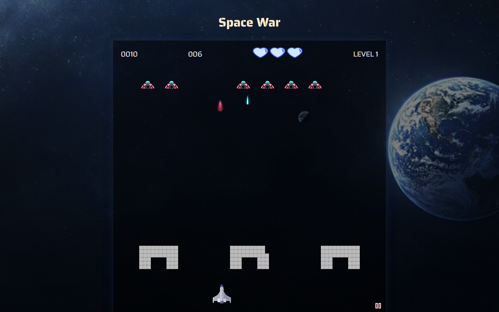
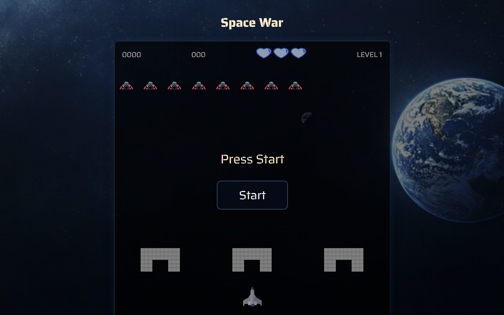

# Space War

A Space Invaders–style arcade shooter built with **vanilla JavaScript, HTML and CSS**. It uses no canvas, no frameworks and no libraries. Every ship, bullet and wall is a DOM element, animated with `requestAnimationFrame`.




## Features

- **Smooth game loop** driven by `requestAnimationFrame`
- **3 levels** that get harder: enemies fire more often at each level, and clearing level 3 wins the game
- **HUD** showing the score, a timer, remaining lives (3 hearts) and the current level
- **Destructible walls** that absorb shots from both sides
- **Pause menu**: press `Esc` at any time to **Continue** or **Restart**
- **Story and level screens** between stages
- Responsive layout that rescales the play area to the window

## Controls

| Key | Action |
|---|---|
| `←` `→` | Move the ship |
| `Space` | Shoot |
| `Esc` | Pause / resume |

## Getting Started

The game is a static website. It uses ES modules, so serve it over HTTP instead of opening `index.html` directly:

```bash
git clone https://github.com/ahmed-jawher/make-your-game.git
cd make-your-game
npx serve .          # or: python3 -m http.server 8000
```

Then open the URL that is printed.

## Screenshots

| Start screen | In game |
|---|---|
|  |  |

## Project Structure

```text
make-your-game/
├── index.html
├── styles.css
├── assets/              # sprites and background images
└── scripts/
    ├── script.js        # game state, HUD, timer, levels, pause handling
    ├── moving.js        # player input, bullets, enemy movement, collisions
    ├── button.js        # start / pause / continue / restart actions
    └── outils.js        # helpers (walls, layout, utilities)
```

## Performance Notes

- All animation runs in a single `requestAnimationFrame` loop instead of `setInterval`
- Movement uses CSS `transform` to avoid layout reflow
- Animation frames are cancelled when the game is paused or a level changes

## Author

**Ahmed Jawher** — [@ahmed-jawher](https://github.com/ahmed-jawher)
